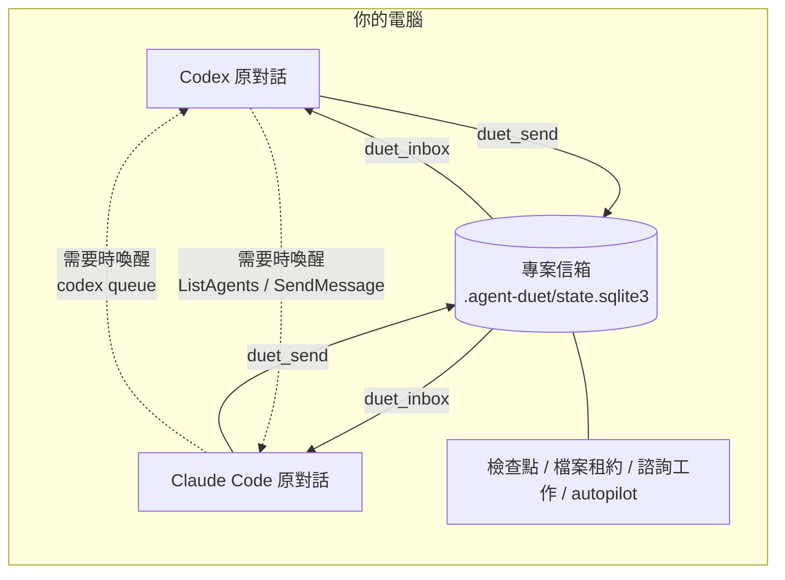

# Agent Duet · Codex × Claude 雙 AI 協作

> 讓你**已經開著的** Codex 對話和 Claude Code 對話，變成同一個專案裡的兩位隊友：
> 各自保留自己的上下文、互相傳訊、互相喚醒、分工、互相審查，一路做到完成——你不用再當人肉複製貼上機。

[](#開發與測試)

-success)


---

## 你是不是也這樣？

- Codex 寫完一段程式，你複製到 Claude 那邊請它審查，再把意見貼回 Codex……一天貼幾十次。
- 開新對話請另一個 AI 幫忙，它什麼都不知道，你又要從頭解釋一遍專案。
- 一個 AI 卡住了，另一個其實知道答案，但它們之間沒有任何通道。
- 晚上想讓兩個 AI 繼續跑，早上起來發現它們都在等你回一句「繼續」。

**Agent Duet 就是為了把你從中間拿掉而做的。**

## 它能做到什麼

| 能力 | 實際效果 |
|---|---|
| 🤝 **原對話配對** | 不開新視窗、不 fork。你原本那個 Codex 對話和 Claude Code 對話直接配成一對，各自保留**完整的原始上下文**。 |
| 🔔 **原生喚醒** | 對方閒置時，透過 Codex 的 `codex queue` 和 Claude Code 原生的 `ListAgents`/`SendMessage` 把它叫起來，在**同一個對話**裡接著做。 |
| 📬 **持久信箱** | 每個專案一個 SQLite 信箱。訊息沒被處理就不會消失；重試不會重複；`reply_to` 串起整段討論。 |
| 🔐 **專案身分綁定** | 每個專案有唯一 ID，綁定到「絕對路徑」。兩個同名資料夾、複製過去的舊狀態，都會被拒絕——AI 不會跑錯專案。 |
| 🧭 **領隊／副手分工** | 一個負責方向與最終決定，另一個負責實作、獨立審查與抓盲點。異議用證據和實驗解決，不會無限辯論。 |
| ✅ **互相審查才算完成** | 寫的人不能自己宣布完成；必須由另一個 AI 對照驗收標準檢查實際成果。 |
| 🤖 **背景自動駕駛** | 想睡覺？`autopilot` 會在背景輪流派 Codex / Claude 工作者實作、交叉審查，直到完成、需要你、或碰到上限。 |
| 🧑‍🔬 **單次諮詢** | 臨時需要第二意見？`duet_consult` 開一個新的 CLI 工作者當審查者／規劃者／除錯者，非同步回報。 |
| 🧠 **模型分級** | 平常用最新標準模型（Codex Sol／Claude `opus`）+ high；真的難才升級（Astra／`fable`），並記錄理由。 |
| 💾 **檢查點** | 每個重要交接都存檔：做了什麼、驗證了什麼、還缺什麼、下一步是誰。隔天、重開機後都能接著做。 |

## 為什麼好用

**1. 你只要說一句話。** 兩邊各貼同一句「用 agent-duet 配對這個專案：路徑、目標」，剩下的配對、驗證通道、分工、交接、審查都由 AI 自己完成。

**2. 上下文不會斷。** 其他「多 AI 協作」工具大多是另開一個全新的 CLI 子程序，什麼都不知道。Agent Duet 的預設路線是喚醒**你原本那兩個對話**——它們已經讀過你的程式、知道你的偏好、記得昨天的討論。

**3. 不會爆燒。** 這套規則是從真實、連續好幾天的雙 AI 專案中磨出來的：
   - 一般更新只進信箱，**不喚醒**對方；只有對方停下來等、或你被它卡住超過 30 分鐘才喚醒。（真實教訓：20 分鐘喚醒 8 次，會讓慢速高階模型的對話被一堆過期通知塞爆。）
   - 交接訊息批次化（約 800–2000 字），不送空的「收到」。
   - 原生喚醒有次數與時間上限（預設 40 次／8 小時），用完就停，不會偷偷重開。

**4. 不會亂做。** 訊息是「資料」不是「命令」：對方不能叫你擴大範圍、改設定或繞過你的權限。檔案編輯先講好誰負責哪個檔案。完成前一定要另一方獨立審查。

**5. 零依賴、跨平台。** 只用 Python 標準函式庫。不開網路連接埠、不裝排程、不裝開機服務。Windows、macOS、Linux 都能裝；Windows 上 npm 安裝的 `codex.cmd`／`claude.cmd` 也能自動解析。

**6. 誠實。** 「已送出（queued）」不等於「對方收到」。配對一定要做雙向 nonce 驗證，才會說「已連線」；上限到了會標示 `limit_reached`，不會假裝完成。

## 真實使用場景

- **多日研究型作業**：Claude 當領隊排實驗、做決策；Codex 當副手實作與獨立審查。Codex 抓到了多 GPU 卡死與佇列 bug，Claude 則把分歧變成可驗證的小實驗，兩邊輪班推進，作者不用在中間傳話。
- **研究計畫設計**：兩個原對話各自讀文獻，互相挑出虛擬碼裡的自相矛盾，最後交出一致、可追溯的設計文件。
- **程式碼審查**：一方寫完，另一方綁定實際 commit/diff 審查；檔案變了就重審變更部分。

---

## 安裝

### 需求

| 項目 | 說明 |
|---|---|
| Python | 3.10 以上（建議 3.11+），只用標準函式庫，不需要 `pip install` |
| Codex CLI | `npm i -g @openai/codex`，並 `codex login` |
| Claude Code | 依官方說明安裝，並登入；**原生喚醒需要 2.1.234 以上**（`claude update`） |
| 同一台電腦 | 兩個對話要在同一台機器、同一個使用者、能看到同一個專案資料夾 |

> 只裝其中一個 CLI 也能安裝：信箱、檢查點和該家的諮詢都能用；「兩個原對話互相喚醒」才需要兩個都裝。

### 步驟

**1. 下載**

```bash
git clone https://github.com/JasonLiaoJCS/agent-duet.git
```

或在 GitHub 頁面按 **Code → Download ZIP** 後解壓縮。

**2. 執行安裝程式**

Windows：雙擊 `agent-duet\install-windows.cmd`，或在終端機執行：

```bash
agent-duet\install-windows.cmd
```

macOS／Linux：

```bash
sh agent-duet/install.sh
```

安裝程式會：
- 把 skill 複製到 `~/.codex/skills/agent-duet` 和 `~/.claude/skills/agent-duet`
- 在 Codex 和 Claude Code 註冊本機 MCP server `agent-duet`（若有 Claude Desktop 也一起註冊）
- 修改任何設定檔前先備份；重複執行是安全的

**3. 決定諮詢工作者的權限（可選）**

預設是 `review`（唯讀）：`duet_consult` 開出來的新 CLI 工作者只能讀、不能改。如果你信任它、希望它直接動手實作，安裝時加上：

```bash
sh agent-duet/install.sh --default-mode work
```

`work` 會讓工作者用 Codex `--dangerously-bypass-approvals-and-sandbox`、Claude `--dangerously-skip-permissions` 執行。**只在你自己的專案、你了解風險時使用。** 之後重裝不加參數會保留你上次的選擇；也可以用環境變數 `AGENT_DUET_DEFAULT_MODE` 臨時覆蓋。

**4. 重新載入**

把 Codex 和 Claude Code 重新開啟一次（或在已開啟的對話裡重新載入 MCP 工具），讓 `duet_*` 工具出現。

**5. 健康檢查**

```bash
python agent-duet/scripts/duet.py call doctor --file - <<< "{}"
```

（Windows PowerShell 可用：`'{}' | python agent-duet\scripts\duet.py call doctor --file -`）

你會看到每個 CLI 的版本、Codex 是否支援 `queue`、Claude 是否夠新，以及 `ready.native_pairing` 是否為 `true`。每個問題都附修正方法。

---

## 使用方法

### 模式一：兩個原對話互相合作（推薦）

在**同一個專案**裡，分別打開一個 Codex 對話和一個 Claude Code 對話，各貼一次同一句話：

```text
用 agent-duet 配對這個專案：C:\path\to\my-project。目標：完成 CSV 匯入功能並通過測試。使用兩邊原本對話的上下文，互相喚醒、分工、檢查到完成。一般任務用最新標準模型、high；困難時才升級。自行建立通道並驗證，有真的需要我決定的事才問我。
```

接下來 AI 會自己：
1. 確認專案的絕對路徑和目標，加入同一個專案 ID
2. 綁定各自真實的對話身分
3. 用隨機 nonce 做雙向驗證——**兩個方向都通了才會跟你說「已連線」**
4. 講好誰是領隊、誰是副手、誰負責哪些檔案、驗收標準是什麼
5. 開始工作、交接、互相審查，直到完成

之後你跟任何一邊說話都可以：

| 你說 | 會發生什麼 |
|---|---|
| `目前進度` | 回報雙方狀態、最新檢查點、待辦 |
| `先暫停雙方` | 停止原生喚醒（狀態 `paused`），信箱保留 |
| `繼續同一專案` | 從最新檢查點接著做 |
| `改成……` | 跟對方協調後更新目標（舊目標會存成檢查點） |

### 模式二：背景自動駕駛（不用開著對話）

```text
用 agent-duet 的 autopilot 在 C:\path\to\my-project 背景完成：把 API 改成分頁回傳。驗收標準：所有測試通過、README 更新。
```

背景監督程式會輪流派 Codex / Claude 工作者實作，再交給另一家獨立審查；進度寫在 `.agent-duet/AUTOPILOT.md`。預設上限 40 輪、8 小時，可依任務調整。完成、需要你、失敗、沒進展、被停止、碰到上限，都有各自不同的狀態，絕不把「上限到了」當成「完成」。

> 注意：autopilot 一定用 `work` 權限（它必須能改檔和跑測試），啟動它就代表你同意。

### 模式三：臨時找第二意見

在任一對話中：

```text
用 agent-duet 請 Claude 當 reviewer，審查 src/parser.py 的邊界條件，找出反例。
```

會開一個新的 CLI 工作者（不是你的原對話），非同步回報結果，你的對話可以繼續做別的事。

---

## 運作方式



- 所有狀態都在專案資料夾的 `.agent-duet/` 裡（建議加進 `.gitignore`，不要上傳）。
- 只有本機 stdio MCP + SQLite，沒有網路監聽、沒有雲端中繼、沒有排程服務。

## 費用與上限

- Agent Duet 本身免費、不需要 API key；它使用你已登入的 Codex / Claude CLI，**照你原本的方案計費**。
- 原生喚醒的 Claude 傳令員每次上限 0.10 美元估算、每輪預設 2 美元估算門檻；這只管傳令員，不管兩個原對話本身的用量。
- 諮詢工作同時最多 2 個、每個預設 10 分鐘。這些是營運上限，不是帳單保證。

## 疑難排解

| 狀況 | 解法 |
|---|---|
| 對話裡看不到 `duet_*` 工具 | 重新開啟 App 或重新載入 MCP 工具；已安裝 ≠ 已開啟的對話已載入。 |
| `doctor` 說找不到 CLI | 確認 `codex`／`claude` 在 PATH 上；或設定 `AGENT_DUET_CODEX_BIN`／`AGENT_DUET_CLAUDE_BIN` 指向實際執行檔。 |
| Claude 版本太舊 | `claude update`，原生跨對話訊息需要 2.1.234+。 |
| 喚醒顯示 `queued` 但對方沒反應 | `queued` 只代表送出。確認對方對話開著、沒睡眠；做一次 nonce 驗證。 |
| 重開機後喚醒失效 | Claude Code 對話重開後位址可能改變：重新 `ListAgents`、重新綁定、再驗證一次。 |
| Claude 收到的訊息被擋住 | 兩邊權限模式不同時可能被暫留；在**該專案**的 `.claude/settings.local.json` 允許 `crossSessionInbound`。 |
| 說「專案狀態屬於別的路徑」 | 你複製或搬移了 `.agent-duet/`。在新路徑重新建立協作，舊的封存起來。 |

## 限制（誠實版）

- 只支援**同一台電腦、同一個使用者**。WSL／容器／VM 內的對話看不到主機上的對話。
- 一般的 Claude Desktop「聊天」不是 Claude Code，無法被原生喚醒。
- 對話關閉、電腦睡眠、登出都會中斷原生喚醒（信箱內容會保留）。
- 檔案租約是「君子協定」，不是作業系統鎖；`review` 模式也不是安全沙箱。
- 模型家族名稱（Sol／Astra／opus／fable）會隨廠商更新而改變，屆時需要更新路由設定。

## 專案結構

```text
agent-duet/                 ← 這整個資料夾就是 skill
├── SKILL.md                ← AI 讀的主要規則
├── install-windows.cmd     ← Windows 安裝
├── install.sh              ← macOS / Linux 安裝
├── agents/openai.yaml      ← Codex 介面顯示設定
├── references/             ← 依需要才讀的細節（原生配對、協作協定、自動駕駛、模型、操作）
└── scripts/
    ├── duet.py             ← MCP server + CLI（信箱、租約、檢查點、諮詢、doctor）
    ├── native.py           ← 原對話綁定與喚醒
    ├── autopilot.py        ← 背景監督程式
    ├── channels.py         ← 實驗性的 Claude channel 推播
    └── install.py          ← 安裝程式
tests/                      ← 69 個單元測試
```

## 開發與測試

```bash
python -X utf8 -m unittest discover -s tests
```

測試涵蓋：專案身分與路徑綁定、並行寫入、訊息去重、租約、諮詢工作的生命週期與中斷復原、原生喚醒的冷卻與上限、autopilot 狀態機、安裝程式的備份與重裝、跨平台 CLI 解析、預設權限模式。

## 授權

MIT License，見 [LICENSE](LICENSE)。

Agent Duet 是獨立實作；設計時參考過 [PAL clink](https://github.com/BeehiveInnovations/pal-mcp-server)、[codex-collab](https://github.com/Kevin7Qi/codex-collab)、[local-agent-bridge](https://github.com/normcrandall/local-agent-bridge) 的想法，但沒有複製它們的程式碼。
