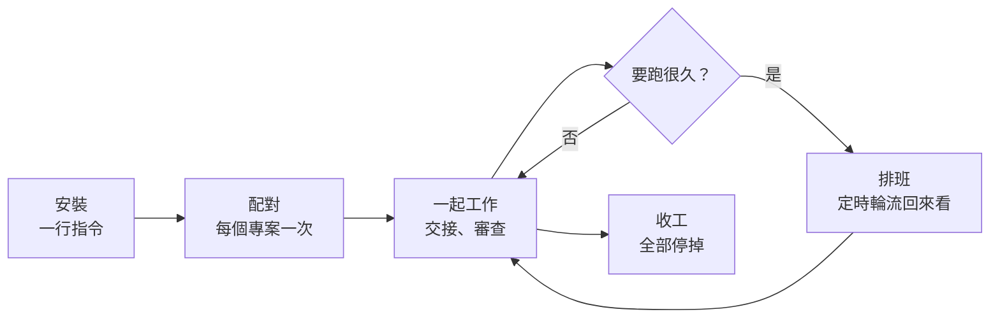
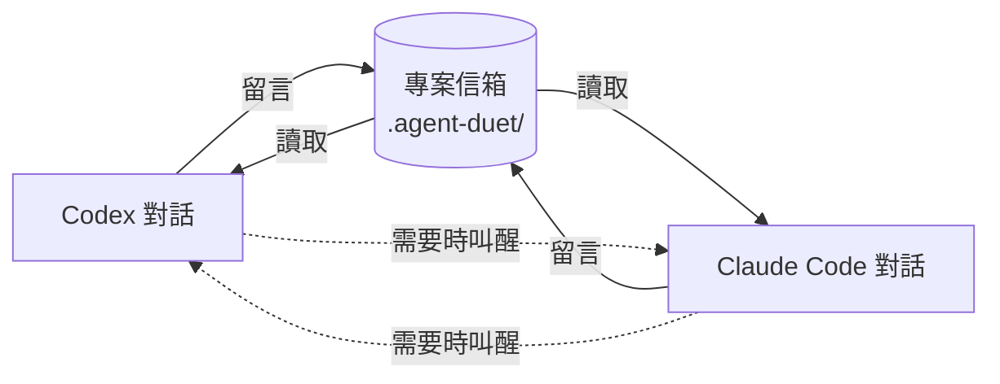

# Agent Duet

讓 Codex 和 Claude Code 在同一個專案裡一起工作。

兩邊用的都是你原本就開著的對話。它們會自己交接、互相檢查，需要的時候把對方叫起來接手，你不用夾在中間複製貼上。

[](https://github.com/JasonLiaoJCS/agent-duet/actions/workflows/tests.yml)


## 為什麼需要它

Codex 和 Claude Code 各有擅長的地方，很多人兩個都在用。麻煩的是它們彼此不認識：想請 Claude 看一下 Codex 剛寫好的東西，你得自己把程式貼過去，再把意見貼回來，每換一次邊還要重新交代前因後果。專案做了幾天之後，光是來回轉貼就很花時間。

已經有工具可以讓一個 AI 去問另一個，做法多半是臨時開一個新的 CLI。新開的 CLI 看得到專案裡的檔案，但它不知道你們之前討論過什麼、為什麼這樣設計、哪些路已經試過行不通。

Agent Duet 接的是你已經在用的那兩個對話，所以這些脈絡都還在。

## 它能做什麼

- **兩個對話直接溝通。** 每個專案有一個存在本機的信箱，兩邊把交接事項留在裡面。對方處理之前訊息不會消失，對方取信了沒有也查得到。
- **需要時叫醒對方。** 對方閒著、而事情正在等它的時候，可以讓它在原本的對話裡接著做。
- **配對一次就好。** 配對紀錄存在專案資料夾裡，隔天或重開機之後，把兩個對話打開就能繼續。
- **互相把關。** 一邊做完，由另一邊對照驗收標準檢查，而不是自己說了算。交付成果時會自動附上當時的 Git 分支、commit 和還沒 commit 的檔案，讓審查的一方知道要看哪一版。
- **模型自己跟上。** 平常用日常的模型，難題才用旗艦。出了新模型不用改設定；你的方案用不了某個模型，它會改用你能用的最好的一款。
- **長期任務可以排班。** 訓練模型、跑很久的工作，可以讓兩邊定時輪流回來看，中間有急事照樣能互相叫醒。
- **出狀況先自己處理。** CLI 過期會自己更新；CLI 被登出會跳通知並開好登入視窗。真的需要你動手的時候才會找你。
- **做完一句話收工。** 背景不留任何東西佔用電腦或額度。

## 三分鐘上手

**1. 安裝**（一行，會自動下載並安裝）

Windows，在 PowerShell 貼上：

```powershell
irm https://raw.githubusercontent.com/JasonLiaoJCS/agent-duet/main/get.ps1 | iex
```

macOS、Linux，在終端機貼上：

```bash
curl -fsSL https://raw.githubusercontent.com/JasonLiaoJCS/agent-duet/main/get.sh | sh
```

需要先有 Python 3.10 以上、Git，以及已經登入的 [Codex CLI](https://www.npmjs.com/package/@openai/codex) 和 [Claude Code](https://code.claude.com/docs)（2.1.234 以上）。只裝了其中一個 CLI 也能用，只是兩個對話要互相叫醒時才需要兩個都裝。

安裝程式改任何設定檔之前會先備份。裝完會告訴你兩個 CLI 有沒有登入，沒登入的話會問你要不要當場登入。

**2. 把 Codex 和 Claude Code 重新開啟一次**，讓它們載入新工具。

**3. 配對**

在同一個專案裡各開一個 Codex 對話和一個 Claude Code 對話。先在其中一邊貼上：

```text
用 agent-duet 配對這個專案：/path/to/project
目標：完成 CSV 匯入功能，測試要全過。
```

它會給你一句「請貼到另一邊」的話，照著貼到另一個對話。

接下來兩邊會自己確認是同一個專案，並且互相驗證訊息真的送得到對方。兩個方向都驗證過，它們才會告訴你配對完成，然後講好誰主導、誰負責哪些檔案，開始工作。

## 整個流程



1. **安裝**一次，所有專案都能用。
2. **配對**：每個專案做一次。之後隔天、重開機都不用重來。
3. **一起工作**：你想知道狀況就問「目前進度」，其他時候它們自己交接。需要你決定的事才會來問你。
4. **排班**（需要才用）：工作要跑很久的時候，讓兩邊定時輪流回來看。預設不排班。
5. **收工**：專案做完說一聲，背景全部停掉。

## 口令表

下面的句子直接對 AI 說，對 Codex 或 Claude 說都可以。這些只是例子，用你自己的話講也行。忘了的時候問它「agent-duet 可以做什麼」，它會把這張表列給你。

| 你想做的事 | 你說 | 會發生什麼 |
|---|---|---|
| 第一次在這個專案使用 | 用 agent-duet 配對這個專案：〈完整路徑〉。目標：〈要完成的事〉 | 檢查環境、配對、驗證通道、分工 |
| 知道做到哪了 | 目前進度 | 回報兩邊狀態、信箱裡還有什麼沒處理、等了多久 |
| 先停一下 | 先暫停 | 暫停互相叫醒和排班，信箱保留 |
| 隔天、重開機後，或暫停之後接著做 | 繼續 | 確認兩邊對話都開著，恢復叫醒和排班，從上次的進度紀錄接下去 |
| 登入完成之後 | 登入好了 | 重做剛才因為沒登入而沒做成的那一步 |
| 換方向 | 目標改成…… | 兩邊對過之後更新目標 |
| 指定分工 | 這次由 Claude 主導，Codex 負責審查 | 照你說的分工 |
| 只想請另一家看一段東西 | 用 agent-duet 請 Codex 審查〈檔案或問題〉 | 另開一個 CLI 去做，做完回報，不動原本的對話 |
| 遇到很難的問題 | 這個用旗艦模型 | 這次換最強的模型，做完換回來 |
| 出了新模型 | 有模型更新 | 重新查最新的模型，順便檢查 CLI 有沒有過期 |
| 長期任務要定時回來看 | 用 agent-duet 排班：輪流 | 兩邊照班表輪流檢查（選項見下方） |
| 看班表、取消班表 | 排班狀況／取消排班 | 顯示或停止排班 |
| 讓它們自己在背景做完 | 用 agent-duet 在背景完成：〈任務〉。驗收標準：〈條件〉 | 兩家在背景輪流實作和審查 |
| 覺得哪裡怪怪的 | 檢查一下 agent-duet | 完整檢查，能修的直接修，修不了才告訴你 |
| 想更新這個工具 | 更新 agent-duet | 自己抓最新版並重新安裝 |
| 專案做完了 | agent-duet 收工 | 停掉所有還在跑的東西，存最後一筆紀錄 |
| 忘了可以說什麼 | agent-duet 可以做什麼 | 列出這張表 |

## 各種情況的細節

### 留在信箱，還是叫醒對方

這兩件事花的額度不一樣。Agent Duet 會自己判斷，但知道差別有助於理解它在做什麼：

- **留在信箱**：把訊息存起來，對方下次做到一個段落時會看到。不花額度。
- **叫醒對方**：讓對方的對話現在就跑一輪。

例如 Claude 改了一個設定檔，只需要讓 Codex 知道，留在信箱就夠了。Claude 做完了、輪到 Codex 審查，而 Codex 正閒著，這時候才叫醒它。

### 只想請另一家看一段東西

不用配對，直接說：

```text
用 agent-duet 請 Codex 審查 src/parser.py 的邊界條件，找出會出錯的輸入。
```

它會另開一個 Codex CLI 去做，做完把結論交回來，不會動到你原本的 Codex 對話。這段時間你可以繼續做別的事。

### 讓它們自己在背景做完

```text
用 agent-duet 在背景完成：把 API 改成分頁回傳。
驗收標準：所有測試通過、README 已更新。
```

Codex 和 Claude 會在背景輪流修改、測試和審查，進度寫在專案的 `.agent-duet/AUTOPILOT.md`。預設最多 40 輪、8 小時。結束時會說明是做完了、需要你決定、失敗了、被停止，還是碰到上限。背景執行期間電腦要開著、不能睡眠。

### 長期任務：讓兩邊排班

有些工作要跑很久，例如訓練模型或做好幾天的專案。跟任何一邊說一句，兩邊的班表會一起排好：

```text
用 agent-duet 排班：輪流
```

把「輪流」換成下面任何一種：

| 你說 | 效果 |
|---|---|
| 輪流 | 每小時換一邊看 |
| Codex 多一點 | 三小時一輪：Claude 看一次，Codex 看兩次 |
| Claude 多一點 | 三小時一輪：Codex 看一次，Claude 看兩次 |
| 密集 | 每 30 分鐘換一邊，適合變化很快的工作 |
| 寬鬆 | 每兩小時換一邊 |
| 過夜 | 每三小時換一邊，適合長時間的訓練 |
| 輪流，每 45 分鐘 | 任何一種都可以自己指定間隔 |
| 自訂：Claude 60 分 → Codex 60 分 → Codex 90 分 | 照你寫的順序和間隔循環 |
| 你們自己決定 | 讓 AI 依任務難度安排，每次看完再決定下次誰看、多久之後看 |
| 你們自己決定，大約每小時一次 | 同上，但先給一個尺度，讓它知道你願意花多少額度。實際要快要慢仍由它決定 |
| 你們自己決定，大約每小時一次，不要超出這個範圍 | 每次間隔會落在這個尺度的一半到兩倍之間 |
| （任何一種）＋ 盯著 runs/train.log，有變化才叫醒 | 檔案沒變就不叫醒任何人，完全不花額度；太久沒動靜也會去看一下 |

也可以多給一點資訊：

```text
用 agent-duet 排班：你們自己決定，持續 48 小時，重點是訓練有沒有發散。
```

值得知道的幾件事：

- **預設不排班。** 配對只是讓兩邊能溝通，不會有任何東西在背景跑。你說要排班才會開始。
- **排班是最少多久看一次，不是只能那時候看。** 中間任何一邊有急事，都可以馬上叫醒對方。
- **每次真的叫醒，就是對方的對話跑一輪。** 每小時一次大約是一天 24 輪。長時間的訓練建議用「有變化才叫醒」或「你們自己決定」。
- **不會白白叫醒。** 輪到的那一邊幾分鐘前才在工作，就不會再叫它；暫停期間會跳過；電腦睡了很久再醒來，只會補看一次；對方一直沒看，信箱裡也只留最新的一則。
- **兩邊都不用自己設排程。** 鬧鐘是 Agent Duet 在背景當的。
- **自訂的順序會從「不是下指令的那一邊」開始**，因為下指令的那一邊正在工作。
- **重開機之後**，把對話打開說「繼續」，班表就會接著跑。

### 做完了：收工

```text
agent-duet 收工
```

它會把這個專案所有還在跑的東西都停掉：排班、互相叫醒、進行中的審查、背景執行，然後存一筆最後的進度紀錄，並告訴你停了哪些東西；萬一有哪個還在收尾，也會照實說。收工之後，這個專案不會再有東西在背景佔用電腦或額度。唯一的例外是對方對話裡已經跑到一半的那一輪，它會自己跑完。

信箱和紀錄都還留著，之後想繼續也不用重新配對。

只是想休息一下的話，說「先暫停」：叫醒和排班會先停住，之後說「繼續」就恢復。背景執行是另一回事，暫停後要再說一次「繼續背景執行」才會接著跑。

### 多個專案、專案搬家

每個專案各自配對、各自有信箱，互不干擾；一個專案配一組對話。專案資料夾如果搬了位置，在新位置重新配對一次就好，舊的紀錄會留著。

## 需要你動手的只有這幾件事

其他的它都會自己處理。

| 事情 | 為什麼只能你來 | 它幫你做到哪裡 |
|---|---|---|
| 安裝後把 App 重新開啟一次 | App 啟動時才會載入新工具 | 安裝完會提醒你 |
| 把配對的句子貼到另一個對話 | 它不能替你在另一個對話裡打字 | 第一邊會把整句話準備好 |
| 登入 CLI | 帳號密碼只能你自己輸入 | 偵測到登出就跳通知、開好登入視窗，你只要在瀏覽器按完 |
| 選原本對話用的模型 | 那是你在 App 裡的設定 | 發現你的對話用的是旗艦模型時會提醒你 |
| 決定方向和範圍 | 這是你的專案 | 只問真的需要你決定的事 |

## 預設值

什麼都沒指定的時候，它是這樣運作的：

| 項目 | 預設 |
|---|---|
| 排班 | 沒有。說要排班才會開始 |
| 背景執行 | 沒有。說要在背景完成才會開始 |
| 模型 | 由 AI 依任務難度和額度自己決定，通常是日常那一款、思考強度 high。你有指定就照你的。不管哪一種，用的都是那個系列的最新版 |
| 另外開的 CLI 的權限 | 只能讀，不能改 |
| CLI 過期時 | 用一行指令安裝的話會自己更新；手動安裝的話預設只會告訴你 |
| 叫醒對方 | 只在對方停下來、而且事情在等它的時候 |

> **建議的設定**
> 想要最省事的話，安裝時加上 `--default-mode work`，並且在 Codex 和 Claude Code 裡讓這個專案使用不必每一步都詢問的權限模式。這樣兩邊才能真的自己把事情做完：自己改檔案、跑測試，而不是每一步都停下來等你按同意。
>
> 這等於把專案資料夾裡的操作交給它們，請只在你信任的專案、而且有版本控制可以復原的情況下這樣設定。想保守一點就維持預設值，它一樣能用，只是需要你確認的時候會比較多。

## 模型

| | 什麼時候用 | 現在是 |
|---|---|---|
| 日常 | 一般的開發、分析、審查 | Codex 的 Sol 系列、Claude 的 Opus |
| 旗艦 | 困難的證明、試過還是解不開的 bug、重大的架構分歧 | Codex 的 Astra 系列、Claude 的 Fable |

表格裡的名字只是目前的情況，設定裡沒有寫死任何版本。

- **版本自己跟上。** 每次要用的時候才查那個系列最新的是哪一版。
- **哪個系列算旗艦，也會重新判斷。** 原則是：旗艦是那一家目前最強的模型；日常是最新的、明顯比旗艦便宜、適合大量使用的那一款。廠商的產品線有變動時，Agent Duet 會發現，並讓 AI 依這個原則重新判斷一次。
- **等級和思考強度由 AI 判斷。** 它會衡量任務難度和額度：一般用日常那一款、強度 high；改名、調整排版這類工作降到 medium；確定是難題才換旗艦或往上調。你明確指定的話就照你的。
- **CLI 太舊會選到舊模型。** 舊的 CLI 看不到後來才出的模型，只會一直選它認得的最新一款，而且不會報錯。我們自己就這樣用了兩個星期的舊模型才發現。現在它每天會檢查一次，開了自動更新就直接在背景更新好。
- **你的方案不含某個模型也沒關係。** 帳號用不了被指定的模型時（方案不含旗艦、沒有權限，或額度用完了），它會改用你用得了的最好的一款，並且明確告訴你這次換成了哪一個。

有一點要留意：以上說的是 Agent Duet **另外開的 CLI** 用哪個模型。你**原本的對話**用哪個模型，是你在 App 裡選的，Agent Duet 改不了。如果 App 預設選的是旗艦，那個對話每次被叫醒都是用旗艦在跑。

## 遇到問題

先試這一句：**「檢查一下 agent-duet」**。它會做一次完整的檢查，能自己修的直接修，修不了的才告訴你要做什麼。

也可以自己在終端機檢查：

```bash
python ~/agent-duet/agent-duet/scripts/duet.py call doctor --pretty
```

| 狀況 | 原因和處理方式 |
|---|---|
| 對話裡找不到 `duet_` 開頭的工具 | 工具還沒載入。把 App 重新開啟一次。 |
| 叫了對方卻沒反應 | 最常見的原因是對方的對話沒開，或電腦在睡眠。再來是 CLI 被登出，見下一列。 |
| 跳出通知說 CLI 需要登入 | App 和 CLI 的登入是分開的，App 能用不代表 CLI 有登入。登入視窗已經幫你開好，在瀏覽器完成登入，再跟 AI 說一聲就能繼續。要自己來的話，執行 `claude auth login` 或 `codex login`。 |
| 重開機之後 | 把兩個對話打開，說「繼續」。不用重新配對。 |
| 用到舊的模型 | 說「有模型更新」。多半是 CLI 過期了，它會更新。 |
| 結果說「改用了另一個模型」 | 你的帳號目前用不了原本指定的那個模型，它改用了能用的最好的一款。隔天會再試一次原本的。 |
| 找不到 CLI | 確認在終端機打得出 `codex` 和 `claude`。裝在特別的位置的話，用環境變數 `AGENT_DUET_CODEX_BIN`、`AGENT_DUET_CLAUDE_BIN` 指過去。 |
| 排班好像沒在跑 | 說「排班狀況」。重開機後要先把對話打開說「繼續」，計時才會恢復。 |
| 提示叫醒次數到上限 | 訊息還在信箱裡，對方下次會看到。真的需要的話，請 AI 調高上限。 |
| 提示專案狀態屬於別的路徑 | 專案資料夾被搬動或複製過。在新的位置重新配對一次。 |
| 專案做完了，不想再讓它跑 | 說「agent-duet 收工」。 |
| 只裝了其中一個 CLI | 可以用。信箱、進度紀錄和請那一家審查都正常，只有兩個對話互相叫醒需要兩個都裝。 |

## 它是怎麼運作的

不想知道細節可以跳過這一節。



**訊息怎麼傳。** 每個專案資料夾裡有一個 SQLite 資料庫，就是信箱。兩個對話各自透過 Agent Duet 提供的工具讀寫它，所以不需要同時在線上：一邊留言，另一邊有空時再讀。叫醒對方則是另一條路：Agent Duet 在背景執行一個指令，把一則很短的通知送進對方的對話，內容只有「信箱裡有你的訊息」。真正的工作內容只存在信箱裡。

**為什麼用桌面 App 還要裝 CLI。** 你平常不用開終端機。CLI 是 Agent Duet 在背景用的：要把訊息送進一個 Codex 對話，官方的方法是 `codex queue` 指令；Claude Code 的跨對話訊息則要由一個 Claude Code 程序去呼叫。

**模型怎麼決定。** 設定裡存的不是「用哪個模型」，而是「日常用哪個系列、旗艦用哪個系列」。要請 Codex 做事時，向本機的 Codex CLI 要一份可用的模型清單，從指定的系列挑版本最高的；Claude 則用 `opus`、`fable` 這種會自動指向最新版的名稱。接著有幾道檢查：清單把選到的模型標成「上一代」，代表 CLI 太舊，會先更新；每天第一次使用前查一次 CLI 有沒有新版；清單出現沒見過的系列，就要求 AI 重新判斷哪個是旗艦。

**平常怎麼用你的額度。** 會用到額度的只有三件事：叫醒對方、另外請一家審查、背景執行。讀寫信箱、存進度紀錄、檢查狀態都不花額度。所以省額度的方法很單純：能留在信箱的就不叫醒；一般工作用日常模型；簡單的工作降低思考強度；確定是難題才用旗艦，做完換回來。

**怎麼確保安全。**

- 每個專案有自己的 ID，綁在資料夾的實際路徑上，每則訊息都要帶著它，對不上就拒絕。不會跑錯專案。
- 對方傳來的內容只是資訊，不能用來擴大工作範圍或更改設定。
- 另外開的 CLI 預設只能讀，要你明確開啟才能改檔案。
- 登入一律由你在瀏覽器完成，Agent Duet 不碰帳號密碼。
- 安裝程式改設定檔之前會留備份，而且只改跟自己有關的那一段。
- 「已送出」和「對方已接手」分開記錄；碰到上限會說是碰到上限，不會說成完成。

**設定存在哪裡。**

| 檔案 | 內容 |
|---|---|
| 專案資料夾的 `.agent-duet/` | 這個專案的信箱、進度紀錄、配對、排班、執行紀錄 |
| `~/.agent-duet/models.json` | 日常和旗艦各用哪個系列、要不要自動更新、上次檢查的時間 |
| skill 資料夾裡的 `settings.json` | 另外開的 CLI 預設是 `review` 還是 `work` |

## 權限、費用與資料

**權限。** 另外開的 CLI 有兩種模式。`review` 只能讀，是預設值。`work` 可以改檔案、執行指令，會用 Codex 的 `--dangerously-bypass-approvals-and-sandbox` 和 Claude 的 `--dangerously-skip-permissions` 來執行；要用的話安裝時加上 `--default-mode work`。背景執行一律是 `work`，因為它得改檔案、跑測試。

**費用。** Agent Duet 本身免費，也不用 API key。它呼叫的是你已經登入的 Codex 和 Claude CLI，用量依各 CLI 的登入方式和計費設定計算。

**資料。** 信箱和進度紀錄存在你的電腦上，放在各專案的 `.agent-duet/` 資料夾。配對時它會自動把這個資料夾加進那個專案的本機 Git 排除清單，所以不會被 commit，也不會動到你的 `.gitignore`。請另一家審查時，你的提示和選取的檔案會經由那個 CLI 送到該模型的服務，這和你平常使用 Codex、Claude 是一樣的。

**連線。** Agent Duet 自己不開網路連接埠，也不安裝排程或開機啟動的服務。它自己會連出去的只有兩件事：向 npm 查 CLI 的最新版本號，以及向 GitHub 查 Agent Duet 有沒有新版。設定環境變數 `AGENT_DUET_OFFLINE=1` 可以關掉這兩個查詢。

**資源。** 平常它不佔資源。只有三種情況會有背景程式：請另一家審查的那幾分鐘、排班期間一個幾乎不耗資源的計時程式，以及背景執行。為了不讓兩邊互相叫個不停，預設每 8 小時最多叫醒對方 40 次；每個專案最多同時請兩個 CLI 做事，整台電腦最多同時跑三個，每個限時 20 分鐘。這些是防止失控用的，不是帳單上限。

## 目前做不到的事

- 兩個對話要在同一台電腦上。在 WSL、容器或虛擬機裡的對話，看不到外面的對話。
- Claude Desktop 的一般聊天不是 Claude Code，沒辦法被叫醒。
- 對話關掉、電腦睡眠或登出的時候，叫不醒對方。信箱裡的訊息還在，等對話開回來就能讀到。
- Codex 那邊有沒有真的被叫醒，沒辦法事先確認，只能從它有沒有回覆來判斷。
- 「這個檔案我在改」只是兩邊之間的約定，系統不會真的鎖住檔案。
- 背景執行在重開機之後不會自己繼續，要你說「繼續」。

## 安裝選項、更新與移除

想自己控制安裝過程的話，可以不用一行指令，改成手動：

```bash
git clone https://github.com/JasonLiaoJCS/agent-duet.git
```

```bash
sh agent-duet/agent-duet/install.sh
```

Windows 用 `agent-duet\agent-duet\install-windows.cmd`。兩者都可以加選項：

| 選項 | 作用 |
|---|---|
| `--auto-update on` | CLI 過期時自己在背景更新（一行指令安裝時預設開啟） |
| `--default-mode work` | 另外開的 CLI 預設可以改檔案、執行指令 |
| `--upgrade` | 先抓最新版的 Agent Duet 再安裝 |
| `--uninstall` | 從這台電腦移除 Agent Duet |
| `--no-login-prompt` | 裝完不要詢問是否登入 |
| `--json` | 以 JSON 輸出完整結果 |

**更新。** 跟 AI 說「更新 agent-duet」就好。也可以再跑一次一行安裝指令，或執行安裝程式加上 `--upgrade`。更新之後原本的專案不用重新設定，信箱、進度紀錄和配對都會保留；已經開著的對話會自己換用新版。如果是從 2.3 或更早的版本升上來，請把 App 重新開啟一次。

**移除。** 執行安裝程式加上 `--uninstall`。它會取消工具的註冊，並把 skill 資料夾移到備份（不會直接刪除）。各專案裡的 `.agent-duet/` 和 `~/.agent-duet/` 不會動，要清掉請自己刪。

## 開發

```bash
python -X utf8 -m unittest discover -s tests
```

測試不會呼叫任何模型，不需要安裝 CLI，不會連網，也不會動到你的 `~/.agent-duet`。每次推送都會在 Windows、macOS 和 Linux 上各跑一遍。測試也會檢查文件和程式是否一致：文件裡提到的每個工具和參數都必須真的存在。

```text
get.sh / get.ps1             一行安裝用的腳本
agent-duet/                  skill 本體，安裝時整個複製過去
├── SKILL.md                 給 AI 讀的規則
├── install-windows.cmd      Windows 安裝
├── install.sh               macOS、Linux 安裝
├── references/              需要時才讀的細節
└── scripts/
    ├── duet.py              信箱、進度紀錄、模型、請另一家審查
    ├── native.py            對話的綁定和叫醒
    ├── schedule.py          排班的計時程式
    ├── autopilot.py         背景執行
    └── install.py           安裝程式
tests/                       單元測試
```

## 授權

[MIT](LICENSE)

設計的時候參考過 [PAL clink](https://github.com/BeehiveInnovations/pal-mcp-server)、[codex-collab](https://github.com/Kevin7Qi/codex-collab) 和 [local-agent-bridge](https://github.com/normcrandall/local-agent-bridge)。Agent Duet 是從頭寫的，沒有用到它們的程式碼。
